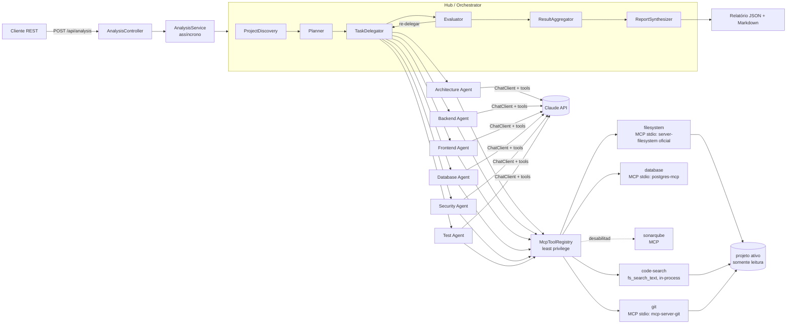
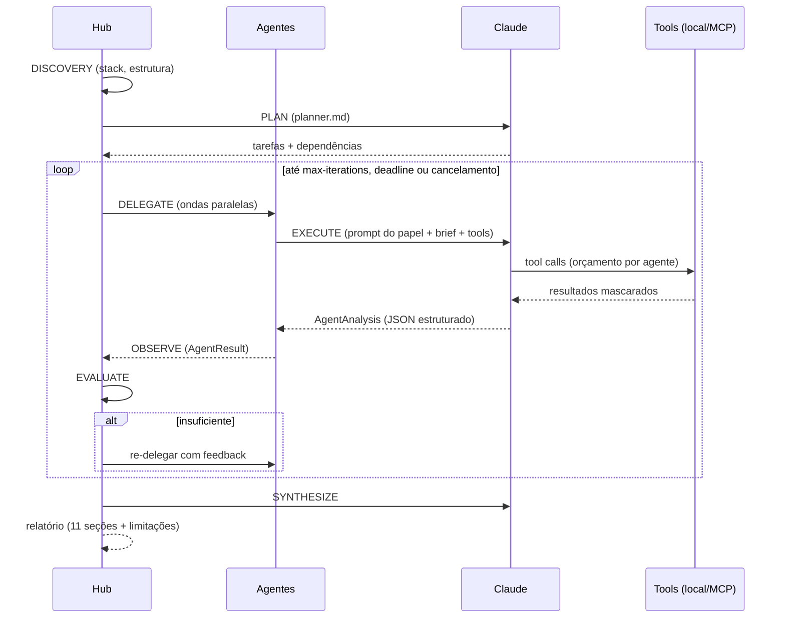

# AgentHub

Orquestração multiagente com **Claude (Anthropic)**, **Spring AI** e **MCP (Model Context Protocol)** para analisar o projeto
[`clientes`](../clientes) (backend Spring Boot `clientes-api` + frontend Angular `clientes-app`).

A análise é **somente leitura**: sandbox na raiz do projeto, allowlist de ferramentas por agente e mascaramento de
segredos. O projeto só é alterado pela [correção assistida](#correção-assistida), com consentimento prévio e revisão de
cada diff.

- Java 25 · Spring Boot 4.1 · Spring AI 2.0 · MCP Java SDK 2.0 · Jackson 3
- Documento de arquitetura: [`docs/ARQUITETURA.md`](docs/ARQUITETURA.md)
- JSON Schemas usados com o Claude (Structured Output e Tool Input Schema): `GET /api/schemas`, página "JSON Schemas"
  da UI e cópia em [`docs/schemas/`](docs/schemas/)
- Especificação original: [`docs/Projeto_Orquestracao_Multiagente_Claude_SpringAI_MCP.docx`](docs/Projeto_Orquestracao_Multiagente_Claude_SpringAI_MCP.docx)

---

## Arquitetura

Topologia **hub-and-spoke**: um único Hub (Orchestrator) planeja, delega, avalia, agrega e sintetiza; os agentes
especialistas nunca conversam entre si — trocam informação apenas pelo Hub (resultados de dependências são repassados
como contexto).



### Papéis do Hub

| Componente | Papel |
|---|---|
| `ProjectDiscoveryService` | Descobre a stack de forma determinística (sem LLM): módulos Maven/Gradle, versões, Angular, infraestrutura, repositórios git. |
| `ContextSelector` | Monta um *brief* por agente (só os caminhos relevantes ao papel) — o projeto inteiro não é enviado a todos. |
| `Planner` | Gera o plano via Claude (`prompts/hub/planner.md`); se falhar, cai para planejamento por regras/palavras-chave. |
| `TaskDelegator` | Executa os agentes em ondas (ordem topológica de dependências), em paralelo com virtual threads, com semáforo global, timeout, retry com backoff e cancelamento. |
| `Evaluator` | Verifica cada resultado (status, confiança mínima, evidências, uso de ferramentas) e re-delega com feedback. |
| `ResultAggregator` | Deduplica e ordena achados por severidade, gera IDs (`SEC-001`, `BCK-002`, ...) e monta as seções. |
| `ReportSynthesizer` | Sumário executivo, Code Quality e roadmap via Claude; fallback por regras. |

### Loop agêntico



### Agentes especialistas

Cada agente é um `@Component` que estende `AbstractClaudeAgent`. O prompt de sistema fica em
`src/main/resources/prompts/agents/<id>.md` e recebe regras de saída comuns (evidência obrigatória, não inventar,
escala de severidade). A resposta é estruturada (`AgentAnalysis` → `AgentResult`).

| Agente | Foco | Fontes de ferramentas |
|---|---|---|
| Architecture | camadas, acoplamento, padrões, dívida técnica | filesystem, code-search, git, sonarqube* |
| Backend | Spring Boot, APIs REST, serviços, tratamento de erros | filesystem, code-search, git, sonarqube* |
| Frontend | Angular, componentes, serviços, RxJS | filesystem, code-search, git, sonarqube* |
| Database | entidades JPA, repositórios, SQL, migrações, banco real (schema, índices, planos) | filesystem, code-search, git, database |
| Security | autenticação/JWT, autorização, segredos, CORS, OWASP | filesystem, code-search, git, sonarqube* |
| Test | cobertura, qualidade e lacunas de testes | filesystem, code-search, git |

\* fonte declarada mas desabilitada (ver [Servidores MCP](#servidores-mcp)).

### Claude, Spring AI e MCP

- **Claude** é o modelo (padrão `claude-sonnet-4-5`) acessado via `spring-ai-starter-model-anthropic`.
- **Spring AI** fornece o `ChatClient`, *tool calling* e saída estruturada (`responseEntity(Class)`).
- **MCP Host / Client**: a aplicação é o *host*; o `spring-ai-starter-mcp-client` cria um *MCP Client* por conexão
  declarada em `spring.ai.mcp.client.stdio.connections`.
- **MCP Server**: processo externo que expõe *tools* (ex.: `mcp-server-git`, iniciado via `uvx`).
- **Tool**: cada ferramenta MCP vira um `ToolCallback`; o `McpToolRegistry` filtra por agente e embrulha cada uma em
  `GuardedToolCallback` (orçamento de chamadas, log, mascaramento e truncamento da saída).

### Segurança (least privilege)

- Cada agente só recebe as fontes listadas em `agenthub.agents.<id>.tool-sources`.
- Cada fonte MCP tem `allowed-tools` (allowlist). Além disso, nomes que indicam escrita
  (`write`, `commit`, `push`, `delete`, `exec`, ...) são bloqueados, a menos que `allow-write: true`.
- `ProjectWorkspace` impede acesso fora da raiz do projeto ativo, fora do escopo escolhido, em diretórios excluídos
  (`.git`, `node_modules`, `target`, ...) e a arquivos sensíveis (`.env*`, chaves, keystores, `.npmrc`, ...).
- Projetos só podem ser cadastrados dentro de `agenthub.targets.allowed-roots` (padrão `C:/Hamden/Sistemas`),
  comparando caminhos reais (links simbólicos não escapam).
- O argumento `repo_path` das ferramentas do MCP Git (`path-arguments`) é validado antes da chamada: só o repositório
  do projeto ativo (ou o que o contém) é aceito; qualquer outro caminho retorna "ACESSO NEGADO".
- `SecretMasker` mascara valores de propriedades/literais com nomes sensíveis (inglês e português: `password`, `secret`,
  `token`, `senha`, `chave-assinatura`, ...), JWTs e formatos conhecidos de chaves — antes de enviar ao Claude e nos logs.
- A chave da API vem só do ambiente (`ANTHROPIC_API_KEY`) e nunca é registrada em log.
- Os relatórios vão para `reports/` (no `.gitignore`), pois podem conter trechos do projeto analisado.
- A única escrita no projeto é a [correção assistida](#correção-assistida): exige consentimento por projeto, revisão e
  confirmação de cada diff, e guarda backup para desfazer.

---

## Como executar

### Pré-requisitos

- Java 25 (o Maven Wrapper incluso baixa o Maven).
- `ANTHROPIC_API_KEY` definida no ambiente.
- Para o MCP Git: [`uv`](https://docs.astral.sh/uv/) instalado (`uvx mcp-server-git` precisa funcionar).
  Sem ele, a aplicação sobe normalmente e a fonte `git` aparece como indisponível.
- Um projeto a analisar dentro de `C:\Hamden\Sistemas`. Na primeira execução, `AGENTHUB_TARGET_ROOT`
  (padrão `../clientes`) vira o projeto ativo; depois, troque pela tela **Projetos** ou por `/api/targets`.

### Variáveis de ambiente

Ver [`.env.example`](.env.example).

| Variável | Padrão | Descrição |
|---|---|---|
| `ANTHROPIC_API_KEY` | — | Obrigatória. |
| `ANTHROPIC_MODEL` | `claude-sonnet-4-5` | Modelo Claude. |
| `ANTHROPIC_MAX_TOKENS` | `8192` | Máximo de tokens de saída por chamada (max_tokens). Cada agente pode reduzir com `max-output-tokens`. |
| `ANTHROPIC_CONTEXT_WINDOW` | `200000` | Tamanho da context window do modelo, em tokens. |
| `AGENTHUB_CONTEXT_BUDGET` | `120000` | Orçamento de contexto por execução (prompts, tool schemas e resultados de ferramentas). Cada agente pode ajustar com `context-budget-tokens`. |
| `AGENTHUB_TARGET_ROOT` | `../clientes` | Projeto inicial, usado só enquanto `data/targets.json` não existe. |
| `AGENTHUB_TARGET_NAME` | `clientes` | Nome do projeto inicial. |
| `AGENTHUB_TARGETS_FILE` | `data/targets.json` | Arquivo com os projetos cadastrados e o ativo (no `.gitignore`). |
| `AGENTHUB_ALLOWED_ROOTS` | `C:/Hamden/Sistemas` | Pastas-base permitidas (lista separada por vírgula). |
| `AGENTHUB_MCP_ENABLED` | `true` | Liga o cliente MCP. |
| `AGENTHUB_UVX_COMMAND` | `uvx` | Comando para iniciar o `mcp-server-git`. |
| `AGENTHUB_REMEDIATION_ENABLED` | `true` | Liga a correção assistida (com `false`, nada é gravado nos projetos). |
| `AGENTHUB_REMEDIATION_DIR` | `data/remediations` | Propostas, consentimentos e backups (no `.gitignore`). |
| `SERVER_PORT` | `8090` | Porta HTTP. |

### Build, testes e execução

Execute a partir da pasta `agenthub` (os caminhos padrão são relativos a ela):

```powershell
.\mvnw.cmd verify                       # compila, roda os testes (sem chamar a API real) e gera JaCoCo
.\mvnw.cmd spring-boot:run              # ou: java -jar target\agenthub-0.1.0-SNAPSHOT.jar
```

### API REST

| Método | Caminho | Descrição |
|---|---|---|
| `POST` | `/api/analysis` | Inicia uma análise (202 + `Location`). |
| `GET` | `/api/analysis` | Lista as análises em memória. |
| `GET` | `/api/analysis/{id}` | Status e eventos de progresso. |
| `GET` | `/api/analysis/{id}/report` | Relatório em JSON (409 enquanto não termina). |
| `GET` | `/api/analysis/{id}/report.md` | Relatório em Markdown. |
| `DELETE` | `/api/analysis/{id}` | Cancela a análise. |
| `GET` | `/api/agents` | Agentes, fontes de ferramentas e disponibilidade. |
| `GET` | `/api/project` | Resultado do discovery do projeto ativo. |
| `GET` | `/api/targets` | Projetos cadastrados, o ativo, pastas permitidas e análises em andamento. |
| `POST` | `/api/targets?activate=true` | Cadastra um projeto (`name`, `root`, `includes`) e, opcionalmente, o ativa. |
| `GET` / `PUT` / `DELETE` | `/api/targets/{id}` | Consulta, altera ou remove (o ativo não pode ser removido). |
| `POST` | `/api/targets/{id}/activate` | Troca o projeto ativo em tempo de execução (409 se houver análise rodando). |
| `GET` | `/api/targets/browse?path=` | Lista pastas para o seletor de diretório (só dentro das pastas permitidas). |
| `GET` | `/api/reports` | Relatórios arquivados em `reports/` (mais recentes primeiro). |
| `GET` | `/api/reports/{reportId}` | Relatório arquivado em JSON. |
| `GET` | `/api/reports/{reportId}/report.md` | Relatório arquivado em Markdown. |
| `GET` / `POST` / `DELETE` | `/api/remediation/consent` | Termos e aceite da correção assistida para o projeto ativo / aceitar / revogar. |
| `GET` | `/api/remediation/proposals?analysisId=` | Propostas de correção de uma análise. |
| `POST` | `/api/remediation/proposals` | Gera uma correção (`analysisId`, `findingId`) — 202, assíncrono; 403 sem consentimento. |
| `GET` / `DELETE` | `/api/remediation/proposals/{id}` | Consulta ou descarta uma proposta. |
| `POST` | `/api/remediation/proposals/{id}/apply` | Grava a correção no projeto (exige `{"confirm": true}`). |
| `POST` | `/api/remediation/proposals/{id}/revert` | Desfaz uma correção aplicada. |

Exemplo:

```powershell
$body = '{"request":"Analise a seguranca da autenticacao JWT do backend","agents":["SECURITY"]}'
Invoke-RestMethod http://localhost:8090/api/analysis -Method Post -ContentType 'application/json' -Body $body
Invoke-RestMethod http://localhost:8090/api/analysis/<id>
Invoke-WebRequest http://localhost:8090/api/analysis/<id>/report.md | Select-Object -Expand Content
```

`agents` é opcional: sem ele, o Planner escolhe os agentes a partir do texto da solicitação
("análise completa" aciona todos). Cada agente consome tokens; prefira escopos menores para reduzir custo.

### Projeto dinâmico

Nada é fixo no código: o projeto analisado é o **projeto ativo**, escolhido na tela **Projetos** (ou via
`/api/targets`) e gravado em `data/targets.json` (escrita atômica, sem banco de dados).

- **Raiz**: qualquer diretório dentro das pastas permitidas.
- **Escopo** (opcional): pastas ou arquivos da raiz — módulos (`clientes-api`) ou pacotes
  (`clientes-api/src/main/java/io/.../security`). Com escopo, discovery e ferramentas só enxergam esses itens, mais os
  arquivos de build (`pom.xml`, `package.json`, `angular.json`, ...) das pastas que levam até eles, para que o
  discovery continue identificando módulos e dependências.
- **Troca em tempo de execução**: a próxima análise já usa o novo projeto, sem reiniciar. A troca é recusada (409)
  enquanto houver análise rodando, e cada análise guarda o projeto e o escopo com que foi feita (no relatório e no
  histórico).

### Relatório

Seções: 1. Executive Summary · 2. Architecture · 3. Backend · 4. Frontend · 5. Database · 6. Security · 7. Tests ·
8. Code Quality · 9. Findings · 10. Recommendations · 11. Roadmap · Limitações (+ metadados: iterações, duração,
agentes, tokens). Gravado em `reports/<data>-<id>.md` e `.json`.

`metadata.agentMetrics` traz o desempenho por agente (duração total e do LLM, tentativas, tokens de entrada/saída,
chamadas de ferramenta por fonte, achados, confiança, modelo); `metadata.usage` separa os tokens do Planner e da
síntese. O Markdown inclui a tabela "Desempenho por agente".

### Correção assistida

Os agentes de análise continuam somente leitura. Corrigir um achado é uma ação separada, sempre iniciada pelo usuário:

1. **Consentimento por projeto**: no primeiro "Corrigir com IA", a UI mostra os termos; sem aceite (gravado em
   `data/remediations/consents.json`), a API responde 403. O aceite pode ser revogado a qualquer momento.
2. **Proposta**: o Claude lê os arquivos (só leitura, mesmas regras do `ProjectWorkspace`, até 25 chamadas) e devolve
   edições `search/replace` em no máximo 8 arquivos, mais passos manuais e riscos. O backend valida tudo (cada trecho
   precisa existir exatamente uma vez) e gera o diff; se algo falhar, pede ao Claude uma nova tentativa.
3. **Revisão**: a UI mostra o diff de cada arquivo. Nada é gravado até o usuário marcar "Revisei" e clicar em
   "Aplicar no projeto".
4. **Aplicação**: confere o SHA-256 de cada arquivo (recusa se ele mudou desde a proposta), guarda o original em
   `data/remediations/<id>/backup/` e grava de forma atômica, desfazendo tudo se um arquivo falhar. Recusada enquanto
   houver análise rodando ou se a análise for de outro projeto.
5. **Desfazer**: restaura os backups, desde que os arquivos não tenham sido alterados depois.

Segredos continuam mascarados: o Claude só vê `***MASKED(n chars)***` e consegue substituir o valor (o trecho mascarado
casa com `n` caracteres) sem conhecê-lo, mas não pode gravar um valor mascarado. Arquivos sensíveis (`.env*`, chaves)
nunca são gravados. Ações fora do código (rotacionar a senha vazada, limpar o histórico do Git) aparecem como passos
manuais. Os backups em `data/remediations` podem conter segredos originais — não versione nem compartilhe essa pasta.

## Interface web (agenthub-ui)

SPA Angular 19.2 (a versão mais recente compatível com Node 20.12; Angular 20+ exige Node ≥ 20.19) em `agenthub-ui/`.

```powershell
cd agenthub-ui
& "C:\Program Files\nodejs\npm.cmd" ci          # npm 10 do Node (o npm global 7.x vem antes no PATH)
& "C:\Program Files\nodejs\npx.cmd" ng serve    # http://localhost:4200, proxy /api -> http://localhost:8090
```

- **Nova análise**: prompt (Ctrl+Enter), modelos prontos, seleção de agentes com disponibilidade das ferramentas e
  estimativa de custo.
- **Execução ao vivo**: fases do loop, estado de cada agente, linha do tempo de eventos, cancelar/reexecutar.
- **Último diagnóstico** (menu lateral, `/diagnostics`): abre direto o relatório mais recente do projeto ativo (ou a
  análise dele em andamento). Também há um botão no cartão do projeto ativo, na tela **Projetos**.
- **Relatório**: visão geral (KPIs, severidades, riscos), achados, áreas, roadmap e desempenho
  (duração, tokens, custo estimado, ferramentas por fonte).
- **Achados**: busca e filtros por severidade, área, categoria e situação da correção; visão em **grade** (colunas
  ordenáveis, paginação de 10/25/50/100, linha expansível com evidências, seleção) ou em **cartões**.
- **Exportação**: Markdown, JSON, CSV/JSON de achados (todos, filtrados ou só os selecionados na grade; o CSV abre no
  Excel pt-BR e inclui a situação da correção), impressão/PDF e cópia do Markdown.
- **Corrigir com IA**: ver [Correção assistida](#correção-assistida).
- **Projetos**: cadastro de diretórios a analisar com seletor de pastas, escopo por módulos/pacotes e troca do
  projeto ativo.
- **Histórico** (análises em memória + relatórios arquivados, com o projeto de cada uma) e **Discovery & agentes**
  (discovery, fontes de ferramentas, matriz de acesso). Tema claro/escuro e layout responsivo.

Build de produção: `npx ng build` (saída em `agenthub-ui/dist/`).

---

## Servidores MCP

| Fonte | Tipo | Situação |
|---|---|---|
| `filesystem` | MCP stdio (`npx @modelcontextprotocol/server-filesystem`) | Ativa, somente leitura por allowlist: `list_directory`, `read_text_file`, `read_multiple_files`, `search_files`, `get_file_info`. Escrita (`write_file`, `edit_file`, `move_file`...) e `directory_tree` bloqueados. Presa ao projeto ativo (ver abaixo). |
| `code-search` | local (in-process, `fs_search_text`) | Ativa. Busca de texto/regex no conteúdo com `arquivo:linha` — o servidor oficial não busca conteúdo nem devolve números de linha. |
| `filesystem-local` | local (in-process, 4 ferramentas `fs_*`) | Reserva para ambientes sem Node/`npx`; não atribuída a agentes. Para usar, troque `filesystem` por `filesystem-local` em `agenthub.agents.<id>.tool-sources`. |
| `git` | MCP stdio (`uvx mcp-server-git`) | Ativa, somente leitura por allowlist. Iniciada sem `--repository`; o `repo_path` de cada chamada é validado contra o projeto ativo. |
| `database` | MCP stdio (`uvx postgres-mcp`, Postgres MCP Pro 0.3.0) | Ativa, só para o Database Agent. Servidor em `--access-mode=restricted` (transação read-only, SQL validado). Allowlist: `list_schemas`, `list_objects`, `get_object_details`, `explain_query`, `analyze_db_health`, `analyze_query_indexes`, `analyze_workload_indexes`, `get_top_queries`; `execute_sql` bloqueado. Banco **por projeto**: a URI é cadastrada na tela Projetos (gravada em `data/targets.json`, exibida com a senha como `***`) e o servidor é recriado ao trocar de projeto. Use um usuário somente leitura, como o `agenthub_ro` de `docs/sql/agenthub-readonly-role.sql`; projeto sem URI deixa a fonte indisponível. |
| `sonarqube` | MCP | Declarada e **desabilitada**: requer servidor SonarQube e token. |

As conexões MCP são inicializadas sob demanda: um servidor fora do ar não derruba a aplicação, apenas aparece como
`available=false` em `/api/agents` e é registrado nas limitações do relatório.

**Filesystem MCP preso ao projeto ativo** (`bind-to-workspace: true`):

- O servidor sobe sem diretório na linha de comando; o Hub informa a raiz do projeto ativo via **MCP Roots** antes
  do `initialize` e, ao trocar de projeto, envia a nova raiz (`roots/list_changed`) e aguarda o servidor confirmar
  (`event=mcp.root` no log). Fora da raiz o próprio servidor responde "Access denied".
- Antes de cada chamada, todo argumento-caminho (`path`, `paths`) passa por `ProjectWorkspace.resolve()` — raiz,
  escopo, diretórios excluídos e arquivos sensíveis (`.env`, chaves) — e segue como caminho absoluto; o modelo usa
  caminhos relativos à raiz, os mesmos devolvidos por `fs_search_text`.
- Listagens (`list_directory`, `search_files`) têm as entradas de diretórios excluídos e fora do escopo removidas;
  todo retorno passa pelo mascaramento de segredos.
- Variáveis: `AGENTHUB_NPX_COMMAND` (default `npx.cmd`) e `AGENTHUB_FILESYSTEM_MCP_VERSION` (default `2026.8.31`).

---

## Como estender

### Adicionar um servidor MCP

1. Declare a conexão em `application.yml`:

   ```yaml
   spring.ai.mcp.client.stdio.connections:
     sonarqube:
       command: docker
       args: [run, -i, --rm, -e, SONARQUBE_TOKEN, -e, SONARQUBE_URL, mcp/sonarqube]
       env:
         SONARQUBE_TOKEN: ${SONARQUBE_TOKEN:}
         SONARQUBE_URL: ${SONARQUBE_URL:http://localhost:9000}
   ```

   Segredos só via `env`/variável de ambiente, nunca nos `args` nem no YAML.

2. Declare (ou habilite) a fonte com allowlist:

   ```yaml
   agenthub.tool-sources:
     sonarqube:
       enabled: true
       type: mcp
       connection: sonarqube         # nome da conexão acima
       allowed-tools: [search_my_sonarqube_projects, get_project_quality_gate_status]
   ```

3. Inclua a fonte nos agentes que devem usá-la (`agenthub.agents.<id>.tool-sources`).

O banco (`database`) é a exceção: a URI muda com o projeto, então o processo é configurado em
`agenthub.project-database` e criado pelo `ProjectDatabaseConnection`, não pelo Spring AI.

Use sempre credenciais somente leitura, vindas de variáveis de ambiente.

### Restringir ferramentas por agente

- Remova a fonte de `agenthub.agents.<id>.tool-sources` para negar todas as ferramentas dela ao agente.
- Ajuste `allowed-tools` da fonte para limitar quais ferramentas existem.
- `max-tool-calls` limita o número de chamadas por execução do agente.
- `agenthub.agents.<id>.enabled: false` desliga o agente.

### Adicionar um agente

1. Adicione o papel em `AgentRole` (id, nome, seção do relatório, prefixo dos achados).
2. Crie `prompts/agents/<id>.md` com o prompt do especialista.
3. Crie a classe:

   ```java
   @Component
   public class PerformanceAgent extends AbstractClaudeAgent {
       public PerformanceAgent(AgentDependencies deps) {
           super(AgentRole.PERFORMANCE, "Gargalos de desempenho, consultas N+1, cache", deps);
       }
   }
   ```

4. Configure `agenthub.agents.<id>.tool-sources` e inclua a seção no relatório/aggregator, se necessário.

O prompt de qualquer agente pode ser sobrescrito sem recompilar: `agenthub.agents.<id>.system-prompt: file:/caminho/prompt.md`.

---

## Decisões e refinamentos em relação ao documento

- **API assíncrona**: `POST` retorna 202 e o progresso é consultado por `GET`; análises completas levam minutos.
- **Discovery determinístico** antes do LLM: barato, reprodutível e alimenta Planner e briefs.
- **Planner com fallback por regras** e Synthesizer com fallback: a análise termina mesmo se uma chamada de
  planejamento/síntese falhar.
- **Avaliação objetiva** (status, confiança, proporção de achados sem evidência, uso de ferramentas) em vez de outro LLM.
- **Concorrência limitada** (`max-parallel-agents`) para respeitar o rate limit da Anthropic.
- **Filesystem híbrido**: servidor MCP oficial para listar e ler, preso ao projeto ativo via MCP Roots e protegido
  pelas regras do workspace; busca de conteúdo (`fs_search_text`) local, porque o servidor oficial não a oferece.
- **Projeto dinâmico** em arquivo JSON (`data/targets.json`) em vez de configuração fixa ou banco relacional.
- **Repositórios e estado em memória** (até 50 análises); os relatórios persistem em disco.

## Estrutura

```text
src/main/java/br/com/hvogel/agenthub
├── agents/        Agentes especialistas, prompts, registry
├── analysis/      Ciclo de vida das análises, repositório, relatório (JSON/Markdown)
├── api/           Controllers REST, DTOs, tratamento de erros
├── claude/        ChatClient, chamadas estruturadas, uso de tokens
├── config/        Propriedades (agenthub.*) e executor de virtual threads
├── context/       Discovery, seleção de contexto, workspace sandbox, mascaramento
├── exception/     Exceções de domínio
├── mcp/           Registry de ferramentas, guarda, conexões MCP
├── model/         Records de domínio (AgentResult, Finding, AnalysisReport, ...)
├── orchestrator/  Planner, TaskDelegator, Evaluator, Aggregator, Synthesizer, Orchestrator
├── target/        Projetos cadastrados, projeto ativo e seletor de pastas (data/targets.json)
└── tools/         Ferramentas locais de filesystem (busca de conteúdo e reserva, somente leitura)
```
