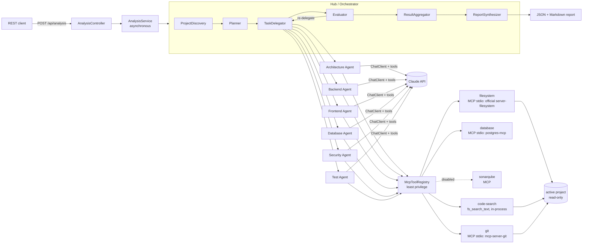
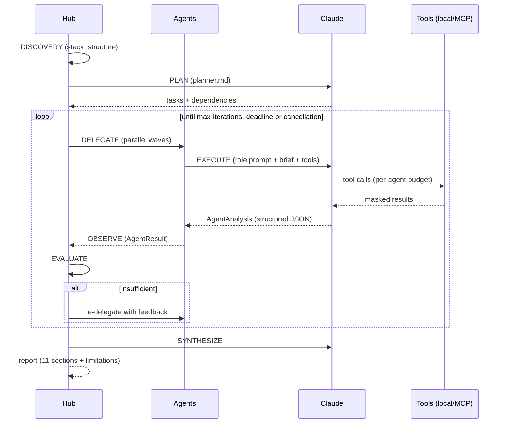

# AgentHub

Multi-agent orchestration with **Claude (Anthropic)**, **Spring AI** and **MCP (Model Context Protocol)** to analyze
existing software projects — for example a Spring Boot backend plus an Angular frontend.

Analysis is **read-only**: sandboxed to the project root, per-agent tool allowlists and secret masking. The analyzed
project is only changed through [assisted remediation](#assisted-remediation), which requires prior consent and a
review of every diff.

- Java 25 · Spring Boot 4.1 · Spring AI 2.0 · MCP Java SDK 2.0 · Jackson 3 · Angular 19
- Architecture document (Portuguese): [`docs/ARQUITETURA.md`](docs/ARQUITETURA.md)
- JSON Schemas used with Claude (Structured Output and Tool Input Schema): `GET /api/schemas`, the "JSON Schemas" page
  in the UI and a copy in [`docs/schemas/`](docs/schemas/)
- Original specification (Portuguese): [`docs/Projeto_Orquestracao_Multiagente_Claude_SpringAI_MCP.docx`](docs/Projeto_Orquestracao_Multiagente_Claude_SpringAI_MCP.docx)

---

## Architecture

**Hub-and-spoke** topology: a single Hub (Orchestrator) plans, delegates, evaluates, aggregates and synthesizes; the
specialist agents never talk to each other — they exchange information only through the Hub (dependency results are
passed along as context).



### Hub roles

| Component | Role |
|---|---|
| `ProjectDiscoveryService` | Discovers the stack deterministically (no LLM): Maven/Gradle modules, versions, Angular, infrastructure, git repositories. |
| `ContextSelector` | Builds a per-agent *brief* (only the paths relevant to the role) — the whole project is not sent to every agent. |
| `Planner` | Produces the plan through Claude (`prompts/hub/planner.md`); on failure, falls back to rule/keyword-based planning. |
| `TaskDelegator` | Runs agents in waves (topological order of dependencies), in parallel on virtual threads, with a global semaphore, timeout, retry with backoff and cancellation. |
| `Evaluator` | Checks each result (status, minimum confidence, evidence, tool usage) and re-delegates with feedback. |
| `ResultAggregator` | Deduplicates and sorts findings by severity, assigns IDs (`SEC-001`, `BCK-002`, ...) and builds the sections. |
| `ReportSynthesizer` | Executive summary, Code Quality and roadmap through Claude; rule-based fallback. |
| `PromptSuggester` | Suggests ready-to-use analysis requests for the selected agents and the active project (UI "Suggest prompts"). |

### Agentic loop



### Specialist agents

Each agent is a `@Component` extending `AbstractClaudeAgent`. Its system prompt lives in
`src/main/resources/prompts/agents/<id>.md` and is combined with shared output rules (mandatory evidence, no
invention, severity scale). The response is structured (`AgentAnalysis` → `AgentResult`).

| Agent | Focus | Tool sources |
|---|---|---|
| Architecture | layers, coupling, patterns, technical debt | filesystem, code-search, git, sonarqube* |
| Backend | Spring Boot, REST APIs, services, error handling | filesystem, code-search, git, sonarqube* |
| Frontend | Angular, components, services, RxJS | filesystem, code-search, git, sonarqube* |
| Database | JPA entities, repositories, SQL, migrations, live database (schema, indexes, plans) | filesystem, code-search, git, database |
| Security | authentication/JWT, authorization, secrets, CORS, OWASP | filesystem, code-search, git, sonarqube* |
| Test | coverage, test quality and gaps | filesystem, code-search, git |

\* source declared but disabled (see [MCP servers](#mcp-servers)).

> Agent prompts and generated reports are currently written in Brazilian Portuguese. To change the output language,
> edit the prompts under `src/main/resources/prompts/` (or override them with `agenthub.agents.<id>.system-prompt`).

### Claude, Spring AI and MCP

- **Claude** is the model (default `claude-sonnet-4-5`), accessed through `spring-ai-starter-model-anthropic`.
- **Spring AI** provides the `ChatClient`, *tool calling* and structured output (`responseEntity(Class)`).
- **MCP Host / Client**: the application is the *host*; `spring-ai-starter-mcp-client` creates one *MCP Client* per
  connection declared in `spring.ai.mcp.client.stdio.connections`.
- **MCP Server**: an external process exposing *tools* (e.g. `mcp-server-git`, started through `uvx`).
- **Tool**: each MCP tool becomes a `ToolCallback`; `McpToolRegistry` filters them per agent and wraps each one in a
  `GuardedToolCallback` (call budget, logging, masking and output truncation).

### Security (least privilege)

- Each agent only receives the sources listed in `agenthub.agents.<id>.tool-sources`.
- Each MCP source has `allowed-tools` (allowlist). In addition, names suggesting writes
  (`write`, `commit`, `push`, `delete`, `exec`, ...) are blocked unless `allow-write: true`.
- `ProjectWorkspace` prevents access outside the active project root, outside the chosen scope, inside excluded
  directories (`.git`, `node_modules`, `target`, ...) and to sensitive files (`.env*`, keys, keystores, `.npmrc`, ...).
- Projects can only be registered inside `agenthub.targets.allowed-roots` (default `C:/Hamden/Sistemas`), comparing
  real paths (symbolic links cannot escape).
- The `repo_path` argument of the Git MCP tools (`path-arguments`) is validated before the call: only the active
  project's repository (or the one containing it) is accepted; any other path returns "ACCESS DENIED".
- `SecretMasker` masks property/literal values with sensitive names (English and Portuguese: `password`, `secret`,
  `token`, `senha`, `chave-assinatura`, ...), JWTs and well-known key formats — before sending to Claude and in logs.
- The API key comes only from the environment (`ANTHROPIC_API_KEY`) and is never logged.
- Reports are written to `reports/` (git-ignored), since they may contain excerpts of the analyzed project.
- The only write to the project is [assisted remediation](#assisted-remediation): it requires per-project consent,
  review and confirmation of every diff, and keeps a backup to undo.

---

## Getting started

### Prerequisites

- Java 25 (the bundled Maven Wrapper downloads Maven).
- `ANTHROPIC_API_KEY` set in the environment.
- For the Git MCP server: [`uv`](https://docs.astral.sh/uv/) installed (`uvx mcp-server-git` must work).
  Without it the application still starts and the `git` source shows as unavailable.
- Node.js (for the Angular UI and the filesystem MCP server via `npx`).
- A project to analyze inside the allowed roots. On first run, `AGENTHUB_TARGET_ROOT` (default `../clientes`) becomes
  the active project; afterwards, switch it on the **Projects** page or through `/api/targets`.

### Environment variables

See [`.env.example`](.env.example).

| Variable | Default | Description |
|---|---|---|
| `ANTHROPIC_API_KEY` | — | Required. |
| `ANTHROPIC_MODEL` | `claude-sonnet-4-5` | Claude model. |
| `ANTHROPIC_MAX_TOKENS` | `8192` | Maximum output tokens per call (max_tokens). Each agent can lower it with `max-output-tokens`. |
| `ANTHROPIC_CONTEXT_WINDOW` | `200000` | Model context window size, in tokens. |
| `AGENTHUB_CONTEXT_BUDGET` | `120000` | Context budget per run (prompts, tool schemas and tool results). Each agent can adjust it with `context-budget-tokens`. |
| `AGENTHUB_TARGET_ROOT` | `../clientes` | Initial project, used only while `data/targets.json` does not exist. |
| `AGENTHUB_TARGET_NAME` | `clientes` | Initial project name. |
| `AGENTHUB_TARGETS_FILE` | `data/targets.json` | File holding the registered projects and the active one (git-ignored). |
| `AGENTHUB_ALLOWED_ROOTS` | `C:/Hamden/Sistemas` | Allowed base folders (comma-separated list). |
| `AGENTHUB_MCP_ENABLED` | `true` | Enables the MCP client. |
| `AGENTHUB_UVX_COMMAND` | `uvx` | Command used to start `mcp-server-git`. |
| `AGENTHUB_REMEDIATION_ENABLED` | `true` | Enables assisted remediation (with `false`, nothing is ever written to projects). |
| `AGENTHUB_REMEDIATION_DIR` | `data/remediations` | Proposals, consents and backups (git-ignored). |
| `SERVER_PORT` | `8090` | HTTP port. |

### Build, test and run

Run from the `agenthub` folder (default paths are relative to it):

```powershell
.\mvnw.cmd verify                       # compiles, runs the tests (no real API calls) and produces JaCoCo
.\mvnw.cmd spring-boot:run              # or: java -jar target\agenthub-0.1.0-SNAPSHOT.jar
```

### REST API

| Method | Path | Description |
|---|---|---|
| `POST` | `/api/analysis` | Starts an analysis (202 + `Location`). |
| `GET` | `/api/analysis` | Lists in-memory analyses. |
| `GET` | `/api/analysis/{id}` | Status and progress events. |
| `GET` | `/api/analysis/{id}/report` | JSON report (409 until finished). |
| `GET` | `/api/analysis/{id}/report.md` | Markdown report. |
| `DELETE` | `/api/analysis/{id}` | Cancels the analysis. |
| `POST` | `/api/prompt-suggestions` | Suggests analysis requests for the given `agents` (optional `draft` to refine). |
| `GET` | `/api/agents` | Agents, tool sources and availability. |
| `GET` | `/api/project` | Discovery result for the active project. |
| `GET` | `/api/about` | Stack versions (Java, Spring Boot, Spring AI, MCP SDK, Claude model, Node.js, OS). |
| `GET` | `/api/targets` | Registered projects, the active one, allowed folders and running analyses. |
| `POST` | `/api/targets?activate=true` | Registers a project (`name`, `root`, `includes`) and optionally activates it. |
| `GET` / `PUT` / `DELETE` | `/api/targets/{id}` | Reads, updates or removes a project (the active one cannot be removed). |
| `POST` | `/api/targets/{id}/activate` | Switches the active project at runtime (409 while an analysis is running). |
| `GET` | `/api/targets/browse?path=` | Lists folders for the directory picker (only inside the allowed folders). |
| `GET` | `/api/reports` | Archived reports in `reports/` (newest first). |
| `GET` | `/api/reports/{reportId}` | Archived report as JSON. |
| `GET` | `/api/reports/{reportId}/report.md` | Archived report as Markdown. |
| `GET` / `POST` / `DELETE` | `/api/remediation/consent` | Assisted remediation terms and consent for the active project / accept / revoke. |
| `GET` | `/api/remediation/proposals?analysisId=` | Remediation proposals of an analysis. |
| `POST` | `/api/remediation/proposals` | Generates a fix (`analysisId`, `findingId`) — 202, asynchronous; 403 without consent. |
| `GET` / `DELETE` | `/api/remediation/proposals/{id}` | Reads or discards a proposal. |
| `POST` | `/api/remediation/proposals/{id}/apply` | Writes the fix to the project (requires `{"confirm": true}`). |
| `POST` | `/api/remediation/proposals/{id}/revert` | Undoes an applied fix. |

Example:

```powershell
$body = '{"request":"Analyze the security of the backend JWT authentication","agents":["SECURITY"]}'
Invoke-RestMethod http://localhost:8090/api/analysis -Method Post -ContentType 'application/json' -Body $body
Invoke-RestMethod http://localhost:8090/api/analysis/<id>
Invoke-WebRequest http://localhost:8090/api/analysis/<id>/report.md | Select-Object -Expand Content
```

`agents` is optional: without it, the Planner picks the agents from the request text (a "full analysis" triggers all
of them). Every agent consumes tokens; prefer narrower scopes to reduce cost.

### Dynamic project

Nothing is hard-coded: the analyzed project is the **active project**, chosen on the **Projects** page (or through
`/api/targets`) and stored in `data/targets.json` (atomic writes, no database).

- **Root**: any directory inside the allowed folders.
- **Scope** (optional): folders or files of the root — modules (`clientes-api`) or packages
  (`clientes-api/src/main/java/io/.../security`). With a scope, discovery and tools only see those items, plus the
  build files (`pom.xml`, `package.json`, `angular.json`, ...) of the folders leading to them, so discovery can still
  identify modules and dependencies.
- **Runtime switch**: the next analysis already uses the new project, without a restart. The switch is refused (409)
  while an analysis is running, and each analysis records the project and scope it ran with (in the report and in the
  history).

### Report

Sections: 1. Executive Summary · 2. Architecture · 3. Backend · 4. Frontend · 5. Database · 6. Security · 7. Tests ·
8. Code Quality · 9. Findings · 10. Recommendations · 11. Roadmap · Limitations (+ metadata: iterations, duration,
agents, tokens). Written to `reports/<date>-<id>.md` and `.json`.

`metadata.agentMetrics` holds per-agent performance (total and LLM duration, attempts, input/output tokens, tool calls
per source, findings, confidence, model); `metadata.usage` separates the Planner and synthesis tokens. The Markdown
includes the "Per-agent performance" table.

### Assisted remediation

Analysis agents remain read-only. Fixing a finding is a separate action, always started by the user:

1. **Per-project consent**: on the first "Fix with AI", the UI shows the terms; without consent (stored in
   `data/remediations/consents.json`) the API answers 403. Consent can be revoked at any time.
2. **Proposal**: Claude reads the files (read-only, same `ProjectWorkspace` rules, up to 25 calls) and returns
   `search/replace` edits in at most 8 files, plus manual steps and risks. The backend validates everything (each
   snippet must occur exactly once) and builds the diff; if anything fails, it asks Claude for another attempt.
3. **Review**: the UI shows each file's diff. Nothing is written until the user ticks "Reviewed" and clicks
   "Apply to project".
4. **Apply**: checks each file's SHA-256 (refuses if it changed since the proposal), backs up the original to
   `data/remediations/<id>/backup/` and writes atomically, rolling everything back if one file fails. Refused while an
   analysis is running or if the analysis belongs to another project.
5. **Undo**: restores the backups, as long as the files were not changed afterwards.

Secrets stay masked: Claude only sees `***MASKED(n chars)***` and can replace the value (the masked snippet matches
`n` characters) without knowing it, but cannot write a masked value. Sensitive files (`.env*`, keys) are never
written. Actions outside the code (rotating a leaked password, cleaning Git history) appear as manual steps. Backups in
`data/remediations` may contain original secrets — do not version or share that folder.

## Web UI (agenthub-ui)

Angular 19.2 SPA (the latest version compatible with Node 20.12; Angular 20+ requires Node ≥ 20.19) in `agenthub-ui/`.

```powershell
cd agenthub-ui
& "C:\Program Files\nodejs\npm.cmd" ci          # Node's npm 10 (the global npm 7.x comes first in the PATH)
& "C:\Program Files\nodejs\npx.cmd" ng serve    # http://localhost:4200, proxy /api -> http://localhost:8090
```

- **New analysis**: prompt (Ctrl+Enter), ready-made templates, agent selection showing tool availability and a cost
  estimate. Includes a **Recent** dropdown (the last 20 submitted requests, stored in the browser) and
  **Suggest prompts with AI**, which proposes project-specific requests for the selected agents.
- **Live run**: loop phases, state of each agent, event timeline, cancel/re-run.
- **Latest diagnosis** (sidebar, `/diagnostics`): opens the most recent report of the active project directly (or its
  running analysis). There is also a button on the active project card, on the **Projects** page.
- **Report**: overview (KPIs, severities, risks), findings, areas, roadmap and performance
  (duration, tokens, estimated cost, tools per source).
- **Findings**: search and filters by severity, area, category and remediation status; **grid** view (sortable
  columns, 10/25/50/100 pagination, expandable row with evidence, selection) or **cards** view.
- **Export**: Markdown, JSON, findings as CSV/JSON (all, filtered or only those selected in the grid; the CSV opens in
  pt-BR Excel and includes the remediation status), print/PDF and copy as Markdown.
- **Fix with AI**: see [Assisted remediation](#assisted-remediation).
- **Projects**: register directories to analyze with a folder picker, scope by modules/packages and switch the active
  project.
- **History** (in-memory analyses + archived reports, each with its project) and **Discovery & agents**
  (discovery, tool sources, access matrix). **Stack** button with the versions in use and their support status.
  Light/dark theme and responsive layout.

Production build: `npx ng build` (output in `agenthub-ui/dist/`).

---

## MCP servers

| Source | Type | Status |
|---|---|---|
| `filesystem` | MCP stdio (`npx @modelcontextprotocol/server-filesystem`) | Active, read-only through the allowlist: `list_directory`, `read_text_file`, `read_multiple_files`, `search_files`, `get_file_info`. Writes (`write_file`, `edit_file`, `move_file`...) and `directory_tree` are blocked. Bound to the active project (see below). |
| `code-search` | local (in-process, `fs_search_text`) | Active. Text/regex search over file contents with `file:line` — the official server neither searches content nor returns line numbers. |
| `filesystem-local` | local (in-process, 4 `fs_*` tools) | Fallback for environments without Node/`npx`; not assigned to agents. To use it, replace `filesystem` with `filesystem-local` in `agenthub.agents.<id>.tool-sources`. |
| `git` | MCP stdio (`uvx mcp-server-git`) | Active, read-only through the allowlist. Started without `--repository`; the `repo_path` of each call is validated against the active project. |
| `database` | MCP stdio (`uvx postgres-mcp`, Postgres MCP Pro 0.3.0) | Active, Database Agent only. Server in `--access-mode=restricted` (read-only transaction, validated SQL). Allowlist: `list_schemas`, `list_objects`, `get_object_details`, `explain_query`, `analyze_db_health`, `analyze_query_indexes`, `analyze_workload_indexes`, `get_top_queries`; `execute_sql` blocked. Database **per project**: the URI is registered on the Projects page (stored in `data/targets.json`, shown with the password as `***`) and the server is recreated when the project changes. Use a read-only user, such as `agenthub_ro` from `docs/sql/agenthub-readonly-role.sql`; a project without a URI leaves the source unavailable. |
| `sonarqube` | MCP | Declared and **disabled**: requires a SonarQube server and token. |

MCP connections are initialized on demand: a server that is down does not bring the application down; it just shows
as `available=false` in `/api/agents` and is recorded in the report limitations.

**Filesystem MCP bound to the active project** (`bind-to-workspace: true`):

- The server starts without a directory on the command line; the Hub provides the active project root through
  **MCP Roots** before `initialize` and, when the project changes, sends the new root (`roots/list_changed`) and waits
  for the server to confirm (`event=mcp.root` in the log). Outside the root the server itself answers "Access denied".
- Before each call, every path argument (`path`, `paths`) goes through `ProjectWorkspace.resolve()` — root, scope,
  excluded directories and sensitive files (`.env`, keys) — and is forwarded as an absolute path; the model uses paths
  relative to the root, the same ones returned by `fs_search_text`.
- Listings (`list_directory`, `search_files`) have entries from excluded or out-of-scope directories removed; every
  result goes through secret masking.
- Variables: `AGENTHUB_NPX_COMMAND` (default `npx.cmd`) and `AGENTHUB_FILESYSTEM_MCP_VERSION` (default `2026.8.31`).

---

## Extending

### Adding an MCP server

1. Declare the connection in `application.yml`:

   ```yaml
   spring.ai.mcp.client.stdio.connections:
     sonarqube:
       command: docker
       args: [run, -i, --rm, -e, SONARQUBE_TOKEN, -e, SONARQUBE_URL, mcp/sonarqube]
       env:
         SONARQUBE_TOKEN: ${SONARQUBE_TOKEN:}
         SONARQUBE_URL: ${SONARQUBE_URL:http://localhost:9000}
   ```

   Secrets only through `env`/environment variables, never in `args` or in the YAML.

2. Declare (or enable) the source with an allowlist:

   ```yaml
   agenthub.tool-sources:
     sonarqube:
       enabled: true
       type: mcp
       connection: sonarqube         # name of the connection above
       allowed-tools: [search_my_sonarqube_projects, get_project_quality_gate_status]
   ```

3. Add the source to the agents that should use it (`agenthub.agents.<id>.tool-sources`).

The database source (`database`) is the exception: its URI changes with the project, so the process is configured in
`agenthub.project-database` and created by `ProjectDatabaseConnection`, not by Spring AI.

Always use read-only credentials coming from environment variables.

### Restricting tools per agent

- Remove the source from `agenthub.agents.<id>.tool-sources` to deny all of its tools to the agent.
- Adjust the source's `allowed-tools` to limit which tools exist.
- `max-tool-calls` limits the number of calls per agent run.
- `agenthub.agents.<id>.enabled: false` turns the agent off.

### Adding an agent

1. Add the role to `AgentRole` (id, name, report section, findings prefix).
2. Create `prompts/agents/<id>.md` with the specialist prompt.
3. Create the class:

   ```java
   @Component
   public class PerformanceAgent extends AbstractClaudeAgent {
       public PerformanceAgent(AgentDependencies deps) {
           super(AgentRole.PERFORMANCE, "Performance bottlenecks, N+1 queries, caching", deps);
       }
   }
   ```

4. Configure `agenthub.agents.<id>.tool-sources` and add the section to the report/aggregator if needed.

Any agent prompt can be overridden without recompiling: `agenthub.agents.<id>.system-prompt: file:/path/prompt.md`.

---

## Design decisions and refinements over the original specification

- **Asynchronous API**: `POST` returns 202 and progress is polled with `GET`; full analyses take minutes.
- **Deterministic discovery** before the LLM: cheap, reproducible, and it feeds the Planner and the briefs.
- **Planner with rule-based fallback** and Synthesizer with fallback: the analysis completes even if a planning or
  synthesis call fails.
- **Objective evaluation** (status, confidence, share of findings without evidence, tool usage) instead of another LLM.
- **Bounded concurrency** (`max-parallel-agents`) to respect Anthropic's rate limits.
- **Hybrid filesystem**: the official MCP server to list and read, bound to the active project through MCP Roots and
  protected by the workspace rules; content search (`fs_search_text`) runs locally, because the official server does
  not offer it.
- **Dynamic project** in a JSON file (`data/targets.json`) instead of fixed configuration or a relational database.
- **In-memory repositories and state** (up to 50 analyses); reports are persisted to disk.

## Project structure

```text
src/main/java/br/com/hvogel/agenthub
├── about/         Stack versions (/api/about)
├── agents/        Specialist agents, prompts, registry
├── analysis/      Analysis lifecycle, repository, report (JSON/Markdown)
├── api/           REST controllers, DTOs, error handling
├── claude/        ChatClient, structured calls, token usage
├── config/        Properties (agenthub.*) and virtual-thread executor
├── context/       Discovery, context selection, sandboxed workspace, masking
├── exception/     Domain exceptions
├── mcp/           Tool registry, guard, MCP connections
├── model/         Domain records (AgentResult, Finding, AnalysisReport, ...)
├── orchestrator/  Planner, PromptSuggester, TaskDelegator, Evaluator, Aggregator, Synthesizer, Orchestrator
├── remediation/   Assisted remediation (proposals, diffs, apply/undo, consent)
├── target/        Registered projects, active project and folder picker (data/targets.json)
└── tools/         Local filesystem tools (content search and fallback, read-only)
```
